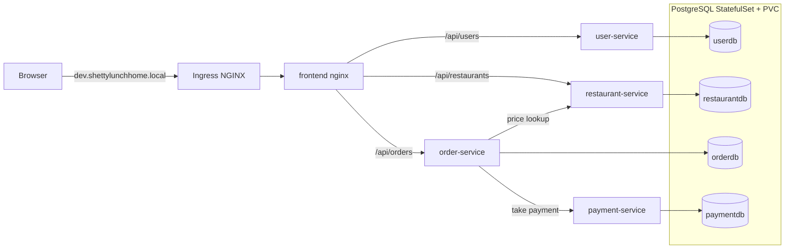
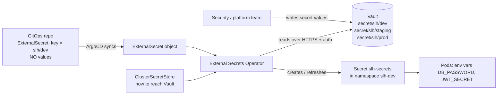

# 🍛 Shetty Lunch Home — Food Delivery Microservices on Kubernetes with GitOps (ArgoCD) — External Secrets Operator edition

A complete, practice-ready DevOps project that follows the flow real IT companies use:
**code → pull request → CI (test, scan, build image) → container registry → GitOps repo → ArgoCD → Kubernetes (dev → staging → prod) → PostgreSQL**.

Everything is here: 4 microservices + web frontend, a database per service, Dockerfiles, docker-compose,
GitHub Actions CI, a separate GitOps repo with Kustomize overlays for three environments, ArgoCD
(app-of-apps, manual gate for prod), scripts, and this guide.

> ## 🔐 Edition: **External Secrets Operator + Vault** (secrets live in a vault, never in git)
> This is the practice project with the plain `base/secret.yaml` **removed**. Secret values live in a vault (HashiCorp Vault in dev mode here, standing in for
> AWS Secrets Manager / Azure Key Vault), and git only contains `ExternalSecret` files that name the *path*. This is how larger companies run it.
> Differences from the basic project: `bootstrap.sh` also installs ESO and Vault and seeds the secrets, new `platform/` folder (ClusterSecretStore),
> `overlays/<env>/external-secret.yaml`, `scripts/seed-vault.sh`, an AWS reference folder, a gitleaks job in CI, and a full chapter: **[section 9](#9-secrets-management-with-external-secrets-operator-eso)**.
> The sibling zip `shetty-lunch-home-sealed-secrets` shows the git-native alternative.
>
> *Testing status of what is new in this edition:* `seed-vault.sh` was run against a stubbed `kubectl` that validates the JSON sent to Vault (keys, lengths,
> idempotence, bad input) and every YAML/cross-reference was validated. The Helm installs of ESO and Vault, the live Vault/ESO calls and the ArgoCD sync were
> **not** run (no cluster/network in the sandbox); the ESO manifests follow the current `external-secrets.io/v1` API docs. If your ESO chart is older and does not know `v1`, see troubleshooting.

> **Read this first — what has and has not been tested (basic project).**
> The project was generated in a sandbox without a Docker daemon, a Kubernetes cluster or access to the npm
> registry. What *was* verified: all JavaScript parses, all 23 YAML files parse, every cross-reference
> (service ports ↔ nginx ↔ ConfigMap URLs ↔ probes ↔ secret keys ↔ image names ↔ overlays ↔ ArgoCD apps ↔ CI matrix)
> is consistent, and the placeholder/promotion scripts work on a copy. What was **not** run: container builds,
> `docker compose up`, the CI pipeline, the cluster deployment. So you may hit a small snag on first run — that is
> normal in real DevOps work and the [Troubleshooting](#14-troubleshooting) section is written for exactly that.

---

## Table of contents

1. [What you are building](#1-what-you-are-building)
2. [How a real company's flow works (and how this project maps to it)](#2-how-a-real-companys-flow-works)
3. [Project layout](#3-project-layout)
4. [Changes YOU must make](#4-changes-you-must-make-checklist)
5. [Prerequisites](#5-prerequisites)
6. [Step-by-step deployment](#6-step-by-step-deployment)
7. [Practice scenarios (do these — this is where you learn)](#7-practice-scenarios)
8. [Database: how it works and how it changes in real life](#8-database)
9. [Secrets management with External Secrets Operator (ESO)](#9-secrets-management-with-external-secrets-operator-eso)
10. [Moving from your laptop to a real cloud](#10-moving-to-a-real-cloud)
11. [Production hardening checklist / what to add next](#11-production-hardening-checklist)
12. [API reference](#12-api-reference)
13. [Cleanup](#13-cleanup)
14. [Troubleshooting](#14-troubleshooting)
15. [Interview talking points](#15-interview-talking-points)

---

## 1. What you are building

### Application (domain: online food ordering)

| Component | Port | Database | Responsibility |
|---|---|---|---|
| `frontend` (nginx) | 8080 (Service: 80) | – | Web UI + single public entry point; reverse-proxies `/api/users`, `/api/restaurants`, `/api/orders` |
| `user-service` | 3001 | `userdb` | Sign up, login (bcrypt + JWT), profile |
| `restaurant-service` | 3002 | `restaurantdb` | Restaurants + menus (seeded with coastal Karnataka restaurants); internal price lookup |
| `order-service` | 3003 | `orderdb` | Places orders: validates JWT, **re-prices items from restaurant-service**, saves order, calls payment-service |
| `payment-service` | 3004 | `paymentdb` | Simulated payment gateway (COD/UPI/CARD). Internal only — not reachable from the internet |
| `postgres` (StatefulSet) | 5432 | 4 databases | One server, **one database per microservice** |

### Architecture



### DevOps toolchain

| Concern | Tool | Where in this project |
|---|---|---|
| Source control | Git + GitHub | two repos (app, gitops) |
| CI | GitHub Actions | `shetty-lunch-home-app/.github/workflows/ci.yml` |
| Container build | Docker (multi-stage, non-root) | `services/*/Dockerfile` |
| Registry | GitHub Container Registry (ghcr.io) | `ghcr.io/<you>/slh-<service>:sha-xxxxxxx` |
| Security scan | Trivy (report-only) | CI job `security-scan` |
| Config management | Kustomize (base + overlays) | `shetty-lunch-home-gitops/base`, `overlays/*` |
| Secrets | External Secrets Operator + HashiCorp Vault (dev mode; stands in for AWS Secrets Manager) + gitleaks scan | `platform/`, `overlays/*/external-secret.yaml`, `scripts/seed-vault.sh` |
| CD / GitOps | ArgoCD (app-of-apps) | `shetty-lunch-home-gitops/argocd/*` |
| Orchestration | Kubernetes (kind locally) | `scripts/kind-config.yaml` |
| Ingress | ingress-nginx | installed by `scripts/bootstrap.sh` |
| Database | PostgreSQL 16 + PVC | `base/postgres.yaml` |
| Autoscaling / availability | HPA + PodDisruptionBudget (prod only) | `overlays/prod/` |

---

## 2. How a real company's flow works

**Golden rule of GitOps: Git is the single source of truth. Nobody (including CI) runs `kubectl apply` against the
cluster. CI only *changes git*; ArgoCD, running inside the cluster, *pulls* from git and makes the cluster match.**

```
Developer ──PR──► app repo (main) ──► GitHub Actions
                                         1. test (unit tests, syntax)
                                         2. trivy security scan
                                         3. docker build + push  ghcr.io/<you>/slh-*:sha-1a2b3c4
                                         4. commit new tag into GitOps repo  overlays/dev/kustomization.yaml
                                                          │
                              GitOps repo (main) ◄────────┘
                                   │  ArgoCD polls git (every ~3 min, or instantly via webhook)
                                   ▼
                  ┌────────── Kubernetes cluster ──────────┐
 dev     (auto)   │ slh-dev      ← ArgoCD app slh-dev      │  auto-sync, self-heal, prune
 staging (auto)   │ slh-staging  ← ArgoCD app slh-staging  │  changes only via promotion PR
 prod  (MANUAL)   │ slh-prod     ← ArgoCD app slh-prod     │  PR + approval, then a human presses SYNC
                  └────────────────────────────────────────┘
```

**Why two repos?** The app repo changes many times a day (every feature); the GitOps repo changes only when a
*deployment* happens. Separate repos give: clean audit trail of "who deployed what, when" (`git log` of the GitOps repo),
different permissions (developers can't silently change prod), and no CI loops (a CI commit to the app repo would
re-trigger CI).

**Promotion** = editing the image tag in the next environment's overlay through a pull request
(`scripts/promote.sh`). **Rollback** = `git revert` in the GitOps repo (or ArgoCD → History → Rollback for an emergency).

**Environment differences** (all in git, all visible in `overlays/`):

| | dev | staging | prod |
|---|---|---|---|
| Namespace | `slh-dev` | `slh-staging` | `slh-prod` |
| Hostname | `dev.shettylunchhome.local` | `staging.shettylunchhome.local` | `prod.shettylunchhome.local` |
| Replicas | 1 each | 2 each | 2 each; `order-service` autoscaled 2–5 (HPA) |
| Image tag updated by | CI bot (automatic) | promotion PR | promotion PR + approval |
| ArgoCD sync | automatic | automatic | **manual** |
| Extras | – | – | HPA, PodDisruptionBudgets |

---

## 3. Project layout

```
shetty-lunch-home/
├── README.md                          ← this file
├── scripts/
│   └── replace-placeholders.sh        ← puts your GitHub username into both repos (step 2)
│
├── shetty-lunch-home-app/             ← REPO 1: application source + CI   (you push this to GitHub)
│   ├── docker-compose.yml             ← run everything locally with one command
│   ├── db/init.sql                    ← creates the 4 databases (local)
│   ├── .github/workflows/ci.yml       ← test → scan → build/push → update GitOps repo
│   └── services/
│       ├── user-service/              ← server.js, package.json, Dockerfile, test/
│       ├── restaurant-service/
│       ├── order-service/
│       ├── payment-service/
│       └── frontend/                  ← index.html, nginx.conf, Dockerfile
│
└── shetty-lunch-home-gitops/          ← REPO 2: desired state of the cluster   (you push this too)
    ├── base/                          ← manifests shared by all environments
    │   ├── postgres.yaml              ← StatefulSet + PVC + headless Service
    │   ├── configmap.yaml                     ← (no Secret in git at all - see section 9)
    │   ├── user-service.yaml … frontend.yaml   ← Deployment + Service each
    │   └── ingress.yaml
    ├── overlays/
    │   ├── dev/kustomization.yaml     ← namespace, image tags (CI edits), host, replicas
    │   ├── staging/kustomization.yaml
    │   └── prod/ (kustomization.yaml, hpa.yaml, pdb.yaml)
    ├── argocd/
    │   ├── project.yaml               ← AppProject (allowed repo + namespaces)
    │   ├── root-app.yaml              ← app-of-apps (applied once by hand)
    │   └── apps/ dev.yaml, staging.yaml, prod.yaml
    └── scripts/
        ├── kind-config.yaml           ← local cluster with ports 80/443 mapped
        ├── bootstrap.sh               ← cluster + ingress + ESO + Vault + seed + ClusterSecretStore + ArgoCD + root app
        ├── seed-vault.sh              ← random secrets into Vault: secret/slh/{dev,staging,prod}
        └── promote.sh                 ← dev→staging→prod tag promotion
    ├── platform/cluster-secret-store.yaml  ← how ESO reaches the vault (platform-team layer)
    └── reference/aws-secrets-manager/      ← same setup with AWS Secrets Manager (reference, untested)
```

---

## 4. Changes YOU must make (checklist)

| # | Change | Where | Why |
|---|---|---|---|
| 1 | Replace `YOUR_GITHUB_USERNAME` with your username | **All files**, done by `./scripts/replace-placeholders.sh <username>` | Image paths (`ghcr.io/<you>/…`) and ArgoCD repo URLs |
| 2 | Create **two** GitHub repos named exactly `shetty-lunch-home-app` and `shetty-lunch-home-gitops` | GitHub | CI checks out `<owner>/shetty-lunch-home-gitops`. If you choose other names, edit `repository:` in `ci.yml` and the `repoURL`s in `argocd/` |
| 3 | Create a fine-grained **Personal Access Token** and store it as secret **`GITOPS_PAT`** in the *app* repo | GitHub → Settings | Lets CI commit the new image tag into the GitOps repo |
| 4 | Make the 5 container packages **public** (or add an imagePullSecret) | GitHub → Packages | ghcr packages are private by default; the cluster can't pull private images without credentials |
| 5 | Keep the GitOps repo **public** (or give ArgoCD credentials) | GitHub / ArgoCD | ArgoCD must be able to clone it |
| 6 | Add 3 hostnames to your hosts file | `/etc/hosts` (Windows: `C:\Windows\System32\drivers\etc\hosts`) | So `dev.shettylunchhome.local` etc. resolve to your machine |
| 7 | *(recommended)* Generate `package-lock.json` in each service | `npm install` in each `services/*` | Reproducible builds; Dockerfile and CI automatically switch to `npm ci` when the lockfile exists |
| 8 | Nothing to edit: `bootstrap.sh` generates random per-environment secrets in Vault (`seed-vault.sh`). To use values of your own, put them in Vault yourself | `scripts/seed-vault.sh`, [section 9](#9-secrets-management-with-external-secrets-operator-eso) | There is no secret value anywhere in the repos |
| 9 | *(optional)* Port 80 busy? Change `hostPort: 80` → `8081` | `scripts/kind-config.yaml` | Then browse `http://dev.shettylunchhome.local:8081` |
| 10 | *(optional)* Use Docker Hub / AWS ECR instead of ghcr | `ci.yml` login step + image names in `base/*.yaml` and `overlays/*` | Only if your company/learning goal uses another registry |

---

## 5. Prerequisites

| Tool | Used for | Check |
|---|---|---|
| Git | version control | `git --version` |
| GitHub account | repos, Actions, container registry | – |
| Docker Desktop / Docker Engine | build images, run kind & compose (give Docker **≥ 6 GB RAM**) | `docker version` |
| `kubectl` | talk to the cluster | `kubectl version --client` |
| `kind` | local Kubernetes in Docker | `kind version` |
| `helm` | installs External Secrets Operator and Vault | `helm version` |
| `openssl` | random secret generation (preinstalled on Linux/macOS/WSL) | `openssl version` |
| Node.js 20+ and npm | generate lockfiles, run tests locally (optional) | `node -v` |
| GitHub CLI `gh` *(optional)* | create repos from terminal | `gh --version` |
| `argocd` CLI *(optional)* | sync/rollback from terminal | `argocd version --client` |

**Windows:** run all shell scripts in **WSL2** (recommended) or Git Bash.

**RAM note:** three environments × (5 services + Postgres) is ~20+ pods. If your machine is small, delete
`argocd/apps/prod.yaml` (and `staging.yaml`) before step 8 and add them back later when you practise promotion.

---

## 6. Step-by-step deployment

### Step 1 — Unzip and look around
```bash
unzip shetty-lunch-home.zip
cd shetty-lunch-home
ls
```

### Step 2 — Put your GitHub username in the project
```bash
./scripts/replace-placeholders.sh <your-github-username>
# example: ./scripts/replace-placeholders.sh akshay-shetty
```
This lower-cases the name (registry paths must be lowercase) and replaces every `YOUR_GITHUB_USERNAME`.
Verify nothing is left (only this README and the script itself mention the word):
```bash
grep -rl YOUR_GITHUB_USERNAME . || echo "all replaced"
```

### Step 3 — (Recommended) Generate lockfiles
```bash
for s in user-service restaurant-service order-service payment-service; do (cd shetty-lunch-home-app/services/$s && npm install); done
```
This creates `package-lock.json` in each service. Commit them. (Also lets you run `npm test` locally.)

### Step 4 — Smoke-test locally with Docker Compose (before any cloud/GitOps)
```bash
cd shetty-lunch-home-app
docker compose up --build
```
Open **http://localhost:8080**: sign up, log in, open a restaurant, add items, place an order (try UPI and COD).
Or use the [curl examples](#12-api-reference). Stop with `Ctrl+C`; `docker compose down -v` also deletes the DB volume.

If this works, your application and Dockerfiles are good. Always do this before debugging Kubernetes.

### Step 5 — Create the two GitHub repos and push (GitOps repo FIRST)
Order matters: CI will push to the GitOps repo's `main` branch, so it must exist first.

```bash
# --- GitOps repo ---
cd shetty-lunch-home/shetty-lunch-home-gitops
git init -b main
git add . && git commit -m "initial gitops config"
gh repo create shetty-lunch-home-gitops --public --source=. --remote=origin --push

# --- App repo ---
cd ../shetty-lunch-home-app
git init -b main
git add . && git commit -m "initial application code"
gh repo create shetty-lunch-home-app --public --source=. --remote=origin
# DON'T push yet - configure secrets first (step 6), otherwise the first CI run fails at the last job.
```
No `gh`? Create the empty repos in the GitHub web UI, then `git remote add origin https://github.com/<you>/<repo>.git && git push -u origin main`.

### Step 6 — GitHub configuration

**6a. Token for CI → GitOps repo** (`GITOPS_PAT`)
1. GitHub → *Settings → Developer settings → Personal access tokens → Fine-grained tokens → Generate new token*.
2. Resource owner: you. Repository access: **Only select repositories → `shetty-lunch-home-gitops`**.
3. Permissions → Repository permissions → **Contents: Read and write**. Generate and copy the token.
4. In the **app** repo: *Settings → Secrets and variables → Actions → New repository secret* → name **`GITOPS_PAT`**, paste the token.

`GITHUB_TOKEN` (used to push images) is provided automatically; nothing to create.

**6b. Allow Actions to publish packages:** app repo → *Settings → Actions → General → Workflow permissions* → keep "Read and write permissions" (the workflow also requests `packages: write` itself).

### Step 7 — Run CI for the first time
```bash
cd shetty-lunch-home-app
git push -u origin main
```
GitHub → app repo → **Actions** tab. You should see: `test` ×4 → `security scan` + `secret scan (gitleaks)` → `build & push` ×5 → `update GitOps repo (dev)`.

Check the results:
* *Your profile → Packages*: five packages `slh-user-service`, `slh-restaurant-service`, `slh-order-service`, `slh-payment-service`, `slh-frontend`, each with tags `sha-xxxxxxx` and `latest`.
* GitOps repo → commits: a commit from `slh-ci-bot` — *"ci: deploy sha-xxxxxxx to dev"* — and `overlays/dev/kustomization.yaml` now has `newTag: sha-xxxxxxx` for all five images.

**Make the packages public** (for each of the 5): *Profile → Packages → package → Package settings → Danger Zone → Change visibility → Public.*
(Alternative for private packages: create an `imagePullSecret` — see [Troubleshooting](#14-troubleshooting) → ImagePullBackOff.)

### Step 8 — Create the cluster, Vault, External Secrets Operator and ArgoCD

```bash
cd shetty-lunch-home/shetty-lunch-home-gitops
./scripts/bootstrap.sh
```
This single script does everything, in seven stages (read it — it is short and commented):

| Stage | What happens | Real-company equivalent |
|---|---|---|
| 1–2 | kind cluster `slh` + ingress-nginx | EKS/AKS/GKE cluster + ingress, built by Terraform |
| 3 | Installs **External Secrets Operator** (Helm, namespace `external-secrets`) | Platform team installs ESO via ArgoCD/Helm |
| 4 | Installs **Vault in dev mode** (namespace `vault`) | AWS Secrets Manager / Azure Key Vault / production Vault |
| 5 | `seed-vault.sh` writes random `DB_USER / DB_PASSWORD / JWT_SECRET` to `secret/slh/dev`, `slh/staging`, `slh/prod` | Security team creates the secrets in the vault; no developer ever sees them |
| 6 | Creates the Secret `vault-token` and the **ClusterSecretStore** `vault-backend` | Platform team connects the cluster to the vault (with IAM/Kubernetes auth, see 9.6) |
| 7 | Installs ArgoCD, the AppProject and the root app | Same as before |

At the end it prints the ArgoCD admin password. Add the hostnames to your hosts file:
```
127.0.0.1 dev.shettylunchhome.local staging.shettylunchhome.local prod.shettylunchhome.local
```
Open the ArgoCD UI:
```bash
kubectl -n argocd port-forward svc/argocd-server 8443:443
# browse https://localhost:8443  (accept the self-signed cert)  user: admin  password: printed by bootstrap.sh
# lost the password?  kubectl -n argocd get secret argocd-initial-admin-secret -o jsonpath="{.data.password}" | base64 -d
```

**Check the secret pipeline end to end** (do this once, slowly):
```bash
kubectl get clustersecretstore                  # vault-backend   STATUS Valid   READY True
kubectl get externalsecret -A                   # slh-dev / slh-staging / slh-prod   STATUS SecretSynced   READY True
kubectl -n slh-dev get secret slh-secrets       # exists - created by ESO, NOT by git
kubectl -n slh-dev describe externalsecret slh-secrets      # refresh interval, last sync time, events
kubectl -n slh-dev get secret slh-secrets -o jsonpath='{.data.DB_USER}' | base64 -d      # slhadmin
```
(The `externalsecret` objects appear after ArgoCD has synced the apps in step 9; give it a couple of minutes.)

### Step 9 — Watch GitOps happen
```bash
kubectl -n argocd get applications -w
```
Within a minute or two you will see `slh-root` → `Synced`, then `slh-dev` and `slh-staging` → `Synced/Healthy`,
and `slh-prod` → **OutOfSync** (that is correct: prod waits for a human).

```bash
kubectl get externalsecret -A                 # SecretSynced for slh-dev / slh-staging / slh-prod
kubectl -n slh-dev get pods            # postgres-0 + 5 services, all Running / Ready
kubectl -n slh-dev logs deploy/order-service
kubectl -n slh-dev get ingress
```
Open **http://dev.shettylunchhome.local** and use the app. (Without editing hosts you can test with
`curl -H "Host: dev.shettylunchhome.local" http://localhost/api/restaurants`.)

Deploy prod once by hand: ArgoCD UI → `slh-prod` → **SYNC** → **SYNCHRONIZE** (or `argocd app sync slh-prod`). Then browse
http://prod.shettylunchhome.local.

> **How fast is "automatic"?** ArgoCD polls git about every 3 minutes. To see changes instantly click **REFRESH** in the UI,
> or configure a GitHub webhook to ArgoCD (what companies do).

---

## 7. Practice scenarios

Do these in order. Each one is a normal day-to-day DevOps task.

### A. Ship a feature through the whole pipeline
1. In the app repo create a branch, change the tagline in `services/frontend/index.html`, commit, push, open a **pull request**.
   CI runs `test` + `scan` only (nothing deploys from a PR).
2. Merge the PR → CI builds new images tagged `sha-<new>` → bot commits the tag to GitOps `overlays/dev`.
3. Watch ArgoCD roll out dev (`kubectl -n slh-dev get pods -w`). Refresh the dev site: new tagline.
   Staging and prod still show the old one — that is the point.

### B. Promote dev → staging → prod
```bash
cd shetty-lunch-home-gitops && git pull
./scripts/promote.sh dev staging
git checkout -b promote-staging && git add overlays/staging && git commit -m "promote to staging" && git push -u origin promote-staging
# open PR on GitHub → review → merge → ArgoCD auto-syncs staging
./scripts/promote.sh staging prod        # after testing staging
# PR (+ approval in a real company) → merge → ArgoCD shows slh-prod OutOfSync → a human presses SYNC
```
Turn on **branch protection** for `main` of the GitOps repo (require PR + 1 approval) to model the real prod gate.
(For the CI bot to still push to `main`, allow your bot/PAT to bypass, or let CI open a PR instead — a common variation.)

### C. Roll back a bad release
1. Introduce a bug: in `order-service/server.js` add `throw new Error('boom')` at the top of the file, push to `main`.
2. CI builds and bot deploys it to dev. The new pod crashes / never becomes Ready; **the old pods keep serving traffic** (rolling update + readiness probes). Observe: `kubectl -n slh-dev get pods`, `kubectl -n slh-dev rollout status deploy/order-service`.
3. Roll back the *GitOps way*: in the GitOps repo `git revert <the bot commit>` and push. ArgoCD restores the previous tag.
   (Emergency alternative: ArgoCD → app → **History and Rollback**; but remember a self-healing app will re-sync to git, so revert git afterwards.)
4. Fix the code in the app repo and ship again.

### D. Self-heal and drift detection
```bash
kubectl -n slh-dev scale deploy/user-service --replicas=5     # manual change = "drift"
kubectl -n slh-dev get pods -w                                 # ArgoCD reverts it to 1 within moments
```
Try it on `slh-prod` too: it shows **OutOfSync** but does **not** revert (no auto-sync there) — discuss why that is a deliberate choice.

### E. Configuration change through git only
Change `ONLINE_PAYMENT_LIMIT` for `payment-service` (add `- name: ONLINE_PAYMENT_LIMIT` / `value: "100"` to the env list in `base/payment-service.yaml`),
commit to the GitOps repo, watch the rollout, then place a UPI order above ₹100 → order status `PAYMENT_FAILED`. COD still works.
(Use `overlays/dev` with a kustomize patch if you want it dev-only.)

### F. Prune and namespace lifecycle
Remove `frontend.yaml` from `base/kustomization.yaml`, commit → ArgoCD **prunes** the Deployment/Service from dev/staging.
Revert the commit → they come back. This is what `prune: true` means.

### G. Autoscaling in prod
Install metrics-server (kind needs an extra flag — see [section 11](#11-production-hardening-checklist)), sync prod, then:
```bash
kubectl -n slh-prod get hpa
```
Generate load against `order-service` (e.g. `hey` or a busy loop of curl) and watch replicas go 2 → 5.

### H. Database operations (see section 8)
Connect with `psql`, inspect tables, take a backup, restore, change an order status by hand.

---

## 8. Database

### How it works here
* One PostgreSQL **StatefulSet** (`postgres-0`) with a 1 GiB **PersistentVolumeClaim** per environment, so data survives pod restarts/redeploys.
* On the **first** start of an empty volume, Postgres runs `init.sql` from the `postgres-initdb` ConfigMap → creates `userdb`, `restaurantdb`, `orderdb`, `paymentdb`.
* **Database-per-service**: each microservice owns its data and connects only to its own database (`DB_NAME` env var). Services never read each other's tables — `order-service` asks `restaurant-service` over HTTP for prices and `payment-service` over HTTP to charge.
* Each service creates its own tables on startup (`CREATE TABLE IF NOT EXISTS`) guarded by a Postgres advisory lock, so 2 replicas starting simultaneously don't collide. `restaurant-service` also seeds three restaurants when its table is empty.
* Credentials come from the `slh-secrets` Secret; host/port from the `slh-config` ConfigMap. The readiness probe (`/ready`) only turns green after the DB is reachable and tables exist, so traffic is never sent to a pod that can't talk to the database.
* Each environment (namespace) has its **own** Postgres and data — dev experiments can never touch prod data.

### Use it
```bash
# open a SQL shell in dev
kubectl -n slh-dev exec -it postgres-0 -- psql -U slhadmin -d orderdb
#   \dt                       list tables
#   SELECT id,status,total_amount FROM orders ORDER BY id DESC LIMIT 5;
#   UPDATE orders SET status='OUT_FOR_DELIVERY' WHERE id=1;     -- simulate the kitchen/rider workflow

# list all databases
kubectl -n slh-dev exec -it postgres-0 -- psql -U slhadmin -d postgres -c '\l'

# connect from your laptop's GUI tool (DBeaver, pgAdmin)
kubectl -n slh-dev port-forward pod/postgres-0 5432:5432     # host=localhost port=5432 user=slhadmin
# password (random, from the Secret):  kubectl -n slh-dev get secret slh-secrets -o jsonpath='{.data.DB_PASSWORD}' | base64 -d

# backup / restore
kubectl -n slh-dev exec postgres-0 -- pg_dump -U slhadmin orderdb > orderdb-$(date +%F).sql
cat orderdb-2026-11-01.sql | kubectl -n slh-dev exec -i postgres-0 -- psql -U slhadmin -d orderdb
```

### Things to know about this setup
* **Data survives** pod deletion and redeploys. It is **lost** if you delete the PVC or the namespace (`prune`/deleting the ArgoCD app with its finalizer removes the namespace objects; PVCs from StatefulSet templates are not auto-deleted, but don't rely on that).
* `init.sql` only runs on an **empty** volume. Editing the ConfigMap later does not create new databases; create them manually.
* Editing the seed list in `restaurant-service/server.js` does not change an already-seeded database — the seed runs only when the table is empty. Update rows with SQL (or wipe the volume in dev).
* Changing a ConfigMap does not restart pods by itself. Use `kubectl -n slh-dev rollout restart deploy/<name>` (or kustomize `configMapGenerator`, which adds a content hash and triggers a rollout automatically).

### What changes in a real company
| Here | Real company |
|---|---|
| Postgres in a StatefulSet | **Managed DB** (AWS RDS/Aurora, Azure Database for PostgreSQL, GCP Cloud SQL): automated backups, point-in-time recovery, multi-AZ failover, patching. Set `DB_HOST` in the ConfigMap to the managed endpoint and remove `postgres.yaml` from that environment. |
| One superuser for every service | **One DB role per service** with least privilege (`user_svc` can only touch `userdb`). |
| Tables created at app start | **Schema migrations** (Flyway / Liquibase / Prisma / node-pg-migrate) run as a pipeline step or Kubernetes Job / ArgoCD **PreSync hook**, versioned in git, reviewed in PRs. |
| Manual `pg_dump` | Scheduled backups (CronJob → object storage, or managed snapshots) + **tested restores**. |
| Same data model in every env | Prod data never copied to dev unless anonymised. |
| Secret in git | **No secret in git at all**: values live in a vault and External Secrets Operator copies them into the cluster ([section 9](#9-secrets-management-with-external-secrets-operator-eso)). |

---

## 9. Secrets management with External Secrets Operator (ESO)

### 9.1 The rules every company follows
1. **A secret value never lives in git** — not even encrypted. Git only says *where* the secret is.
2. **Every environment has different secrets** (`slh/dev`, `slh/staging`, `slh/prod`).
3. **Humans do not know production passwords.** They are generated randomly and only the running application reads them.
4. **One central, audited system of record** (AWS Secrets Manager, Azure Key Vault, GCP Secret Manager, HashiCorp Vault) with access control, audit logs and rotation.

The basic project broke rule 1 on purpose (`base/secret.yaml`). **This edition fixes it** the way large companies do. (`docker-compose.yml` keeps throwaway values such as `slhpassword` because it only runs on your own laptop; never reuse them anywhere real.)

### 9.2 How External Secrets Operator works

Two kinds of objects:
* **`ClusterSecretStore`** (`platform/cluster-secret-store.yaml`) — *how to connect* to the backend (address, auth). Owned by the platform team, installed once.
* **`ExternalSecret`** (`overlays/<env>/external-secret.yaml`) — *which secret to fetch* and what Kubernetes Secret to create. Owned by the application team, lives in git, contains **no secret value**.

ESO re-reads the backend every `refreshInterval` (dev 1 min, staging 5 min, prod 1 h in this project), so **rotating a secret in the vault reaches the cluster automatically** — no commit, no pull request.

### 9.3 Who owns what
| Piece | Owner in a real company | In this project |
|---|---|---|
| Vault / Secrets Manager and the secret values | Security / platform | Vault dev-mode pod, filled by `scripts/seed-vault.sh` |
| `ClusterSecretStore` + operator install | Platform | `platform/cluster-secret-store.yaml`, installed by `bootstrap.sh` |
| `ExternalSecret` | Application team | `overlays/<env>/external-secret.yaml` (in git, reviewed in PRs) |
| Deployments that consume `slh-secrets` | Application team | unchanged |

### 9.4 What this edition changed
| File | Change |
|---|---|
| `shetty-lunch-home-gitops/base/secret.yaml` | **Deleted** (no Secret object in git at all) |
| `platform/cluster-secret-store.yaml` | **New**: Vault connection, restricted to the three `slh-*` namespaces |
| `overlays/<env>/external-secret.yaml` | **New**: points to `slh/<env>`; listed in each overlay's `kustomization.yaml` |
| `scripts/bootstrap.sh` | Also installs ESO + Vault, seeds Vault, creates the store (7 stages, see step 8) |
| `scripts/seed-vault.sh` | **New**: random per-environment secrets into Vault |
| `reference/aws-secrets-manager/` | **New**: how the same setup looks with AWS Secrets Manager (reference, untested here) |
| `shetty-lunch-home-app/.github/workflows/ci.yml` | **New job `secret-scan`** (gitleaks) |
| Deployments, Postgres, services | **No change.** They still read Secret `slh-secrets`. |

### 9.5 Practice exercises (do them — this is what interviews ask)

**A. Read the secret straight from the vault (practice only — never do this casually in real life).**
```bash
kubectl -n vault exec -it vault-0 -- sh -c 'VAULT_TOKEN=root vault kv get -mount=secret slh/dev'
kubectl -n vault exec -it vault-0 -- sh -c 'VAULT_TOKEN=root vault kv list -mount=secret slh'
```
Compare with `kubectl -n slh-dev get secret slh-secrets -o yaml` (values are base64 — decode one with `base64 -d`). Same values, two places: the vault is the truth, the Secret is a copy.

**B. Rotate the JWT secret centrally — no git involved.**
```bash
kubectl -n vault exec -it vault-0 -- sh -c 'VAULT_TOKEN=root vault kv patch -mount=secret slh/dev JWT_SECRET=$(head -c 32 /dev/urandom | od -An -tx1 | tr -d " \n")'
sleep 70      # dev refreshInterval is 1m
kubectl -n slh-dev get secret slh-secrets -o jsonpath='{.metadata.resourceVersion}{"\n"}'   # changed
kubectl -n slh-dev rollout restart deploy/user-service deploy/order-service                 # env vars are only read at pod start
```
Log in again in the browser. Real teams automate the restart with **Stakater Reloader** (restarts pods when a Secret changes). Force an immediate refresh without waiting:
`kubectl -n slh-dev annotate externalsecret slh-secrets force-sync=$(date +%s) --overwrite`.

**C. Break it and read the error (debugging skill).**
```bash
kubectl -n vault exec -it vault-0 -- sh -c 'VAULT_TOKEN=root vault kv metadata delete -mount=secret slh/staging'
kubectl -n slh-staging describe externalsecret slh-secrets          # SecretSyncedError: secret not found  (within ~5 min, or force-sync as above)
kubectl -n slh-staging get secret slh-secrets                       # STILL EXISTS: deletionPolicy Retain keeps the last good copy, apps keep running
./scripts/seed-vault.sh staging                                     # put it back
```
**Careful:** `seed-vault.sh` generates **new random** values, and Postgres still has the old password. Align it, then restart:
`kubectl -n slh-staging exec postgres-0 -- psql -U slhadmin -d postgres -c "ALTER USER slhadmin PASSWORD '<new DB_PASSWORD from the vault>'"` and `kubectl -n slh-staging rollout restart deploy`.
(Real lesson: a secret and the thing it protects must always change together.)

**D. Namespace guard rail.**
```bash
kubectl create namespace scratch
kubectl -n scratch apply -f - <<'EOF'
apiVersion: external-secrets.io/v1
kind: ExternalSecret
metadata: {name: steal-prod}
spec:
  secretStoreRef: {name: vault-backend, kind: ClusterSecretStore}
  target: {name: stolen}
  dataFrom: [{extract: {key: slh/prod}}]
EOF
kubectl -n scratch describe externalsecret steal-prod        # error: not allowed by the store's namespace `conditions`
kubectl delete namespace scratch
```
Without the `conditions` block in the store, any namespace — or any compromised pod's team — could pull **prod** secrets.

**E. Vault forgets everything (why dev mode is only for practice).**
```bash
kubectl -n vault delete pod vault-0          # dev mode stores secrets in MEMORY only
kubectl -n slh-dev describe externalsecret slh-secrets     # sync errors - but the existing Secret is retained, apps keep running
./scripts/seed-vault.sh all                  # re-create (NEW random values) -> then align Postgres passwords as in exercise C
```
Production Vault uses persistent storage, HA, auto-unseal and backups; managed services (AWS Secrets Manager) are durable by default.

**F. Catch a leak.** On a throw-away branch of the app repo add a line such as `AWS_SECRET_ACCESS_KEY=AKIAIOSFODNN7EXAMPLEwJalrXUtnFEMI/K7MDENG/bPxRfiCYEXAMPLEKEY` and open a PR.
The `secret scan (gitleaks)` job reports it (report-only while practising; remove `continue-on-error: true` in `ci.yml` to make it block). Delete the branch afterwards.

### 9.6 From practice to production: the "secret zero" problem
ESO must authenticate to the vault somehow. In this practice setup it uses a **static token** (`vault-token`, the dev root token) created by `bootstrap.sh`. That is the one secret that still lives "outside" the system — the *secret zero*. Real companies remove it:

| Backend | Authentication without a stored password |
|---|---|
| AWS Secrets Manager | **IRSA** (IAM Roles for Service Accounts): the operator's ServiceAccount assumes an IAM role limited to `secretsmanager:GetSecretValue` on `slh/*`. See `reference/aws-secrets-manager/`. |
| Azure Key Vault | Workload Identity (managed identity federated to the ServiceAccount) |
| GCP Secret Manager | Workload Identity |
| HashiCorp Vault | **Kubernetes auth method** (Vault validates the ServiceAccount token) and per-environment **policies** (`slh-dev` policy can only read `secret/data/slh/dev`) |

Other production practices: **separate stores/accounts per environment** (a dev token must be physically unable to read prod), audit logging in the vault, automatic rotation (Secrets Manager rotation Lambdas, Vault dynamic database credentials), Stakater Reloader for restarts, and **pinning the ESO chart version** instead of "latest".

### 9.7 Limits and trade-offs
* One more moving part to run and monitor (the operator, plus the vault itself).
* If the vault is down, *new* secrets can't be created, but existing Kubernetes Secrets keep working (`deletionPolicy: Retain`).
* The Kubernetes `Secret` is still a copy in etcd: restrict RBAC and enable etcd encryption at rest.
* ArgoCD shows a permanent `OutOfSync` on ExternalSecrets in some versions because the operator fills in default fields. The manifests here already set those defaults explicitly; if you still see it, add to the Application:
  ```yaml
  spec:
    ignoreDifferences:
      - group: external-secrets.io
        kind: ExternalSecret
        jsonPointers: [/spec/data, /spec/dataFrom, /spec/refreshInterval]
  ```

The sibling zip, **`shetty-lunch-home-sealed-secrets`**, implements the other approach with the same application so you can compare them side by side.

---

## 10. Moving to a real cloud

Same repos, same pipeline. What changes:

| Area | Local (kind) | Cloud (EKS / AKS / GKE) |
|---|---|---|
| Cluster | `kind create cluster` | Created with Terraform (`eks`/`aks`/`gke` module). Terraform code lives in a third repo (IaC). |
| Ingress | NodePort via kind port mappings | `ingress-nginx` Service of type `LoadBalancer` (or ALB / AGIC / GCE ingress) |
| DNS + TLS | `/etc/hosts`, HTTP | Route53/Cloud DNS records → the load balancer; **cert-manager + Let's Encrypt**; real hostnames in the overlay `patches` and `tls:` block on the Ingress |
| Registry | ghcr.io | ghcr.io still works; or ECR/ACR/GAR (change CI login step + image names) with cluster pull permissions via IAM roles (IRSA / Workload Identity) |
| Database | StatefulSet | RDS/Cloud SQL (section 8) |
| Storage class | kind default | `gp3`/`managed-csi`/`pd-balanced` via `storageClassName` |
| Secrets | Vault dev mode + static token | AWS Secrets Manager / Azure Key Vault / GCP Secret Manager with IRSA / Workload Identity (no static token); see `reference/aws-secrets-manager/` |
| ArgoCD access | port-forward | Ingress + SSO (OIDC/GitHub/Okta), RBAC per team |
| Clusters | 1 cluster, 3 namespaces | Usually separate clusters (nonprod / prod), registered in ArgoCD; change `destination.server` per Application |

---

## 11. Production hardening checklist

Not included (to keep practice manageable) but expected in real projects — good "next steps":

- [ ] **Observability**: Prometheus + Grafana (`kube-prometheus-stack`), `/metrics` via `prom-client`, Loki/ELK for logs, alerts (Alertmanager), uptime checks. Add tracing with OpenTelemetry.
- [ ] **NetworkPolicies**: default-deny; allow only frontend→services, order→restaurant/payment, services→postgres. (kind's default CNI doesn't enforce them; use Calico/Cilium.)
- [ ] **ResourceQuota / LimitRange** per namespace; **PodSecurity** `restricted` labels.
- [ ] **Argo Rollouts** for canary / blue-green releases with automatic analysis.
- [ ] **ArgoCD Notifications** (Slack/Teams on sync failed/degraded) and a GitHub webhook for instant sync.
- [ ] **Image signing** (cosign) + admission policy (Kyverno/OPA) + pin images by digest; Trivy on the built *images*, not just the repo, and make the scan blocking.
- [ ] **SonarQube/SAST**, dependency updates (Dependabot/Renovate), required status checks and CODEOWNERS on both repos.
- [ ] **Integration/e2e tests** in CI (compose or kind) and smoke tests after deploy (ArgoCD PostSync hook).
- [ ] **Per-service build filters** (only rebuild services whose folder changed) — currently all 5 images rebuild on every push.
- [ ] **Backups/DR**: scheduled DB backups, restore drills, multi-AZ.
- [ ] **ArgoCD ApplicationSet** to generate per-environment apps from one template; **ArgoCD Image Updater** as an alternative to CI committing tags.

**Optional: metrics-server on kind (needed for the prod HPA)**
```bash
kubectl apply -f https://github.com/kubernetes-sigs/metrics-server/releases/latest/download/components.yaml
kubectl -n kube-system patch deployment metrics-server --type=json \
  -p '[{"op":"add","path":"/spec/template/spec/containers/0/args/-","value":"--kubelet-insecure-tls"}]'
```

---

## 12. API reference

Base URL: `http://localhost:8080` (compose) or `http://dev.shettylunchhome.local` (cluster). Public endpoints go through the frontend nginx.

| Method & path | Auth | Purpose |
|---|---|---|
| `POST /api/users/register` | – | `{name,email,password,phone?,address?}` |
| `POST /api/users/login` | – | → `{token,user}` (JWT, 8 h) |
| `GET /api/users/:id` | Bearer | own profile only |
| `GET /api/restaurants` | – | list |
| `GET /api/restaurants/:id` | – | details |
| `GET /api/restaurants/:id/menu` | – | menu items |
| `POST /api/orders` | Bearer | `{restaurantId, items:[{menuItemId,quantity}], paymentMethod: COD\|UPI\|CARD, deliveryAddress}` → order with status `CONFIRMED` or `PAYMENT_FAILED` |
| `GET /api/orders` | Bearer | my orders |
| `GET /api/orders/:id` | Bearer | one order with items |
| `POST /api/orders/:id/cancel` | Bearer | cancel (PLACED/CONFIRMED/PAYMENT_FAILED) |
| `GET /health`, `GET /ready` | – | liveness / readiness on every service (internal) |
| `GET /api/menu-items/:id`, `POST /api/payments` | internal | **not** exposed through nginx/ingress on purpose |

```bash
BASE=http://localhost:8080
curl -s -X POST $BASE/api/users/register -H 'Content-Type: application/json' \
  -d '{"name":"Demo User","email":"demo@example.com","password":"secret123","address":"MG Road, Bengaluru"}'
TOKEN=$(curl -s -X POST $BASE/api/users/login -H 'Content-Type: application/json' \
  -d '{"email":"demo@example.com","password":"secret123"}' | python3 -c 'import sys,json;print(json.load(sys.stdin)["token"])')
curl -s $BASE/api/restaurants
curl -s $BASE/api/restaurants/1/menu
curl -s -X POST $BASE/api/orders -H "Authorization: Bearer $TOKEN" -H 'Content-Type: application/json' \
  -d '{"restaurantId":1,"items":[{"menuItemId":1,"quantity":2},{"menuItemId":3,"quantity":1}],"paymentMethod":"UPI","deliveryAddress":"MG Road, Bengaluru"}'
curl -s $BASE/api/orders -H "Authorization: Bearer $TOKEN"
```
Seeded menu item ids: restaurant 1 → 1-5, restaurant 2 → 6-10, restaurant 3 → 11-15.

---

## 13. Cleanup

```bash
kind delete cluster --name slh                 # removes the whole local cluster, ArgoCD, all data
cd shetty-lunch-home-app && docker compose down -v
```
GitHub: delete the two repos and the 5 packages if you no longer need them. Remove the hosts-file lines.

---

## 14. Troubleshooting

Method: **GitHub Actions → registry → GitOps repo commit → ArgoCD app status → pods → logs.** Find the first broken link.

| Symptom | Likely cause | Fix |
|---|---|---|
| CI `update-gitops` fails: *Input required: token* / `403` / `Repository not found` | `GITOPS_PAT` secret missing, expired, wrong repo scope, or the GitOps repo name differs | Redo step 6a; confirm repo is `<owner>/shetty-lunch-home-gitops` and has a `main` branch |
| CI `build & push` fails with `denied: permission_denied` | Workflow permissions read-only, or an existing package is owned by another repo | Settings → Actions → Workflow permissions → Read and write; package settings → manage Actions access |
| CI `test` fails: `Cannot find module` | dependencies not installed / lockfile out of sync | `npm install` in that service, commit the lockfile |
| Pods `ImagePullBackOff` / `ErrImagePull` | Package is private, tag doesn't exist yet, or username typo | Make packages public; `kubectl -n slh-dev describe pod <pod>`; check `newTag` exists in the Packages page. Private packages: `kubectl -n slh-dev create secret docker-registry ghcr --docker-server=ghcr.io --docker-username=<you> --docker-password=<PAT with read:packages>` and add `imagePullSecrets: [{name: ghcr}]` to each Deployment pod spec |
| ArgoCD app `ComparisonError` / `repository not found` / auth required | Repo is private or URL wrong | Make repo public, or ArgoCD UI → Settings → Repositories → Connect (HTTPS, username + PAT); verify `repoURL` in `argocd/*.yaml` |
| Argo app `Unknown` or *project not permitted* | `project.yaml` not applied, or namespace/repo not in project | `kubectl apply -f argocd/project.yaml`; compare `destinations`/`sourceRepos` |
| `slh-prod` is `OutOfSync` | **Expected** — manual sync | Press SYNC |
| Browser: `404 Not Found` from nginx | Wrong host header / host not in hosts file / ingress not ready | `kubectl -n slh-dev get ingress`; `curl -H "Host: dev.shettylunchhome.local" http://localhost/`; `kubectl -n ingress-nginx get pods` |
| Browser can't connect | Port 80 in use / Docker not mapping | Change `hostPort` in `kind-config.yaml`, recreate cluster (`kind delete cluster --name slh`) and use `:8081` |
| Pod `CrashLoopBackOff` | App error | `kubectl -n slh-dev logs <pod> --previous` |
| Pods Running but `0/1` Ready | `/ready` is 503: DB not reachable or init failed | `kubectl -n slh-dev logs deploy/user-service` → "db not reachable"; check `postgres-0` is Ready and `DB_HOST/DB_NAME/secret` match |
| `postgres-0` Pending | No storage class / PVC unbound | `kubectl -n slh-dev get pvc`; `kubectl get storageclass` (kind ships `standard`) |
| `postgres-0` error `initdb: directory exists but is not empty` | PGDATA must be a sub-directory of the mount | already set (`PGDATA=/var/lib/postgresql/data/pgdata`); delete the PVC if you changed it |
| `database "userdb" does not exist` | Volume was initialised before `init.sql` existed | `kubectl -n slh-dev exec -it postgres-0 -- psql -U slhadmin -d postgres -c 'CREATE DATABASE userdb;'` (or delete PVC in dev) |
| nginx frontend `host not found in upstream "order-service"` | Service for that name missing in the namespace | `kubectl -n slh-dev get svc`; all services must exist (they are in `base/`) |
| Order status `PAYMENT_FAILED` | Online payment above `ONLINE_PAYMENT_LIMIT` (default ₹20000) or payment-service down | Use COD / lower amount; check `payment-service` logs |
| `401 invalid or expired token` | `JWT_SECRET` differs between `user-service` and `order-service`, or token expired | Both read `slh-secrets/JWT_SECRET`; log in again |
| ArgoCD keeps reverting my `kubectl` change | `selfHeal: true` — by design | Change git instead |
| Bot commit conflicts with your GitOps commit | Both pushed to `main` | CI does `git pull --rebase` before pushing; just retry the failed job |
| ExternalSecret `SecretSyncedError`: *secret not found* / *key not found* | Vault path missing or wrong `key` | `./scripts/seed-vault.sh <env>`; compare `key: slh/<env>` in `overlays/<env>/external-secret.yaml` with `vault kv list -mount=secret slh` |
| ClusterSecretStore `READY False` / *permission denied* / 403 | `vault-token` Secret missing/wrong, or Vault not ready | `kubectl -n vault get pod vault-0`; recreate: `kubectl -n external-secrets create secret generic vault-token --from-literal=token=root --dry-run=client -o yaml \| kubectl apply -f -` |
| ExternalSecret error about the namespace or store *conditions* | The namespace is not in the store's allow-list | Add it to `conditions` in `platform/cluster-secret-store.yaml` and `kubectl apply -f` it (or use the three `slh-*` namespaces) |
| `no matches for kind "ExternalSecret" in version "external-secrets.io/v1"` | Older ESO chart without the `v1` API | `helm repo update && helm upgrade external-secrets external-secrets/external-secrets -n external-secrets --set installCRDs=true`; or change `apiVersion` to `v1beta1` in `platform/` and `overlays/*/external-secret.yaml` |
| Pods `CreateContainerConfigError`: `secret "slh-secrets" not found` | ESO has not created the Secret yet (store not ready, or path missing) | `kubectl get clustersecretstore,externalsecret -A`; fix the first non-ready item; pods start by themselves once the Secret exists |
| Services log `password authentication failed for user "slhadmin"` | Secret was re-seeded (new random password) but Postgres kept the old one | `ALTER USER` in Postgres to the new value, restart pods (section 9.5 C) |
| Vault pod restarted and everything is `SecretSyncedError` | Dev-mode Vault keeps data in memory only | `./scripts/seed-vault.sh all`, then align Postgres passwords (section 9.5 E) |
| Changed a secret in Vault but the app still uses the old value | Env vars are read at pod start; ESO also waits for `refreshInterval` | Force-sync (annotation in 9.5 B), then `kubectl rollout restart deploy/<name>` |
| ArgoCD shows the apps permanently `OutOfSync` because of ExternalSecret | Operator fills default fields | See `ignoreDifferences` snippet in section 9.7 |
| `helm: command not found` | Tool not installed | See prerequisites |

Useful commands:
```bash
kubectl -n argocd get applications
kubectl -n argocd describe application slh-dev
kubectl -n slh-dev get all
kubectl -n slh-dev describe pod <pod>
kubectl -n slh-dev logs deploy/order-service -f
kubectl -n slh-dev get events --sort-by=.lastTimestamp
kubectl kustomize overlays/dev          # render exactly what ArgoCD will apply (needs kubectl ≥ 1.14)
```

---

## 15. Interview talking points

* *"Walk me through your CI/CD."* PR → CI tests/scans → image built once, tagged with the git SHA (immutable, never `latest` in deployments) → CI commits the tag to the GitOps repo → ArgoCD pulls and syncs → promotion between environments is a PR; prod needs approval and a manual sync.
* *"Why GitOps instead of `kubectl apply` from Jenkins?"* Git is the audit log, rollbacks are `git revert`, the cluster credentials never leave the cluster (pull model), drift is detected and healed.
* *"Why Kustomize overlays?"* One base, small per-environment differences (replicas, host, tag) — no copy-pasted manifests.
* *"How do services talk and what is public?"* Only the frontend is behind the ingress; nginx exposes just three API prefixes; menu-item lookup and payments are internal ClusterIP services. `order-service` never trusts prices from the browser.
* *"How do you handle the database?"* Database-per-service, PVC-backed StatefulSet for dev, managed DB + migrations + per-service roles in prod, secrets from a vault, backups and restore drills.
* *"What happens on a bad deploy?"* Readiness probes + rolling update keep the old pods serving; revert the GitOps commit; ArgoCD rolls back.
* *"How do you manage secrets in GitOps?"* Secrets live in a central vault (AWS Secrets Manager / Vault) with per-environment paths and IAM policies. In git there is only an `ExternalSecret` that names the path, never a value. **External Secrets Operator** authenticates with a workload identity (IRSA), fetches the value and creates the Kubernetes Secret; it re-syncs on an interval so rotation in the vault flows to the cluster, and Reloader restarts the pods. A `ClusterSecretStore` restricted by namespace conditions stops one team reading another environment's secrets, and gitleaks in CI catches accidental commits.
* *"What would you improve?"* Observability, NetworkPolicies, canary releases with Argo Rollouts, image signing, per-service pipelines, IaC for the cluster.

Happy practising! 🍛
